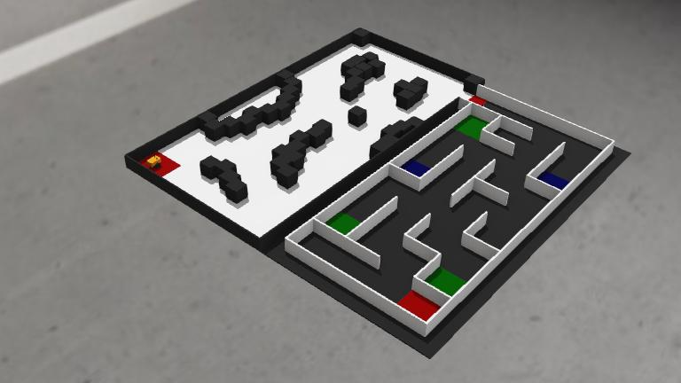

# CircuitBreakers — PeraBots 2026

An autonomous two-wheel robot controller for the PeraBots university
challenge in Webots R2025a. The robot navigates an obstacle field, enters
a maze, counts coloured floor tiles, and stops at the end cell with the
LED matching the more frequent colour.



The white floor is the obstacle-navigation section. The black floor is
the maze, with blue and green tiles and a red end cell.

## How it works

### Section 1: obstacle navigation

Six distance sensors measure the space around the robot. Wheel encoders
and an inertial unit estimate its position and heading as it builds an
occupancy grid. A* finds routes around obstacles, with clearance for the
robot's body, and path smoothing reduces unnecessary turns.

The robot searches the arena boundary for the transition opening rather
than following a fixed route. At the opening, it centres between the
walls and uses the floor camera to detect the red-to-black edge. It
checks its heading and first-cell position before beginning the maze.

### Section 2: maze exploration

The robot explores the 4 × 9 maze using depth-first search and
backtracking. At each cell, it records walls from the front and side
distance sensors and classifies the floor using several camera samples.
Blue and green tiles are counted once per cell.

After all cells have been visited, breadth-first search finds the shortest
route through the mapped maze to the detected red end cell. The robot
stops fully inside that cell and activates the blue or green LED according
to the tile counts. A conservative entry timer checks the three-second
stop-and-LED requirement. A tie or an unconfirmed end cell produces a
diagnostic stop instead of a guessed result.

### Motion and sensing

Forward movement uses wheel encoders for distance and inertial feedback
for heading correction. Turns use absolute cardinal headings in the maze.
Acceleration limits and gradual braking keep movement stable. Invalid
sensor readings, excessive tilt, and motion faults stop the robot.

Obstacle positions, maze walls, and coloured-tile locations are learned
during the run. Section 1 uses the known arena dimensions and assumes the
supplied starting-zone centre, facing along the long side with the field
to the robot's right. A dedicated maze run starts at the first-cell centre,
facing into the maze.

## Running the simulation

1. Open `worlds/Arena.wbt` in **Webots R2025a**.
2. Reset the simulation to the saved starting pose.
3. Run the simulation. The default `full` mode identifies the starting
   section from the floor camera and handles the transition automatically.

Open `worlds/MazeTest.wbt` to run the maze on its own. The same default
controller recognises the maze floor without code changes.

The robot's `controllerArgs` can select a specific mode:

| Mode | Behaviour |
| --- | --- |
| `full` | Detect the starting section and complete the course. Default. |
| `section1` | Navigate the obstacle field and stop at the verified maze entrance. |
| `maze` | Begin maze exploration from the designated first cell. |

For example:

```vrml
controllerArgs [ "--mode=maze" ]
```

## Project structure

| Path | Purpose |
| --- | --- |
| `controllers/main_controller/main_controller.py` | Controller entry point. |
| `controllers/main_controller/competition.py` | Starting-section selection and continuous handoff. |
| `controllers/main_controller/obstacle_navigation.py` | Occupancy mapping, A* planning, and entrance alignment. |
| `controllers/main_controller/maze_navigation.py` | Maze exploration, wall mapping, and final-cell navigation. |
| `controllers/main_controller/floor_detection.py` | Camera sampling and floor-colour classification. |
| `controllers/main_controller/floor_map.py` | Unique tile counts, observation checks, and shortest paths. |
| `controllers/main_controller/movement.py` | Encoder-based forward movement and heading correction. |
| `controllers/main_controller/turning.py` | Heading-controlled turns. |
| `protos/` | Arena, obstacle, and robot definitions. |
| `worlds/` | Full-course and dedicated-maze simulation worlds. |
| `tests/` | Automated checks and simulation validation records. |

## Validation

Run the automated checks with:

```sh
python3 -B -m unittest discover -s tests
```

The checks cover floor classification, tile counting, path planning,
movement, turning, section selection, entrance verification, and the
final-cell timing budget. Measured simulation results and their scope
are recorded in [tests/VALIDATION.md](tests/VALIDATION.md).
